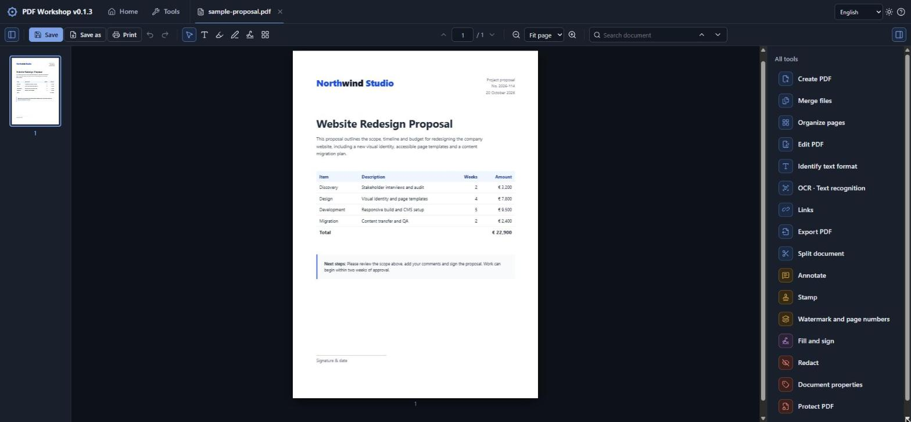
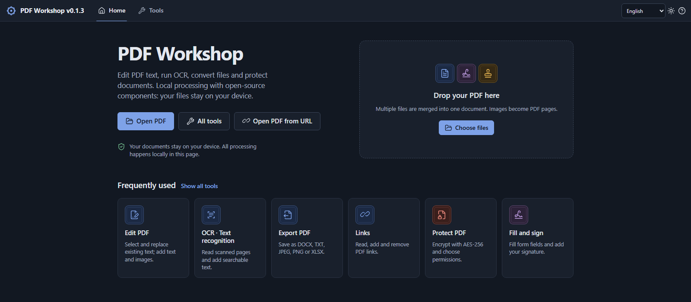

<h1 align="center">PDF Workshop</h1>

<p align="center">
  A free, open-source PDF editor that runs entirely in your browser.<br>
  Edit text, run OCR, convert, sign and protect PDFs. Your files never leave your device.
</p>

<p align="center">
  <a href="https://github.com/smyrna-pergamum/PDF-Werkstatt/releases/latest"></a>
  <a href="LICENSE"></a>
  
  
</p>

<p align="center">
  <a href="https://smyrna-pergamum.github.io/PDF-Werkstatt/"><b>▶ Try it online</b></a>
  &nbsp;·&nbsp; <a href="https://github.com/smyrna-pergamum/PDF-Werkstatt/releases/latest"><b>⬇ Download offline version</b></a>
  &nbsp;·&nbsp; <a href="#tools-and-features">Features</a>
  &nbsp;·&nbsp; <a href="#quick-start">Quick start</a>
</p>



PDF Workshop is a browser-based PDF editor with local document processing. It
needs no installation, no account and no upload: PDF files and passwords are
processed on your device. Use it online, or download a single HTML file that
also works without an internet connection.

The interface starts in **English**. Turkish and German interface options are
also available. Changing the interface language does not translate document
content or existing annotations.

## Quick start

1. **Online:** open <https://smyrna-pergamum.github.io/PDF-Werkstatt/>.
   **Offline:** download the offline version from the
   [latest release](https://github.com/smyrna-pergamum/PDF-Werkstatt/releases/latest),
   extract it and open `index.html` in Chrome, Edge or Firefox.
2. Choose **Choose files**, or drag a PDF/image into the window.
3. Select a tool, make changes and use **Save**, **Save as** or **Export PDF**.



`index.html` is self-contained (about 64 MiB): PDF engines, fonts, the OCR worker
and all 14 OCR language models are embedded. External links need a connection.
The browser may remember the language, theme and signatures you explicitly
choose to remember; document files and passwords are not saved to local storage.

`PDF-Workshop-online.html` loads basic PDF/font/ZIP libraries from CDNs and needs
internet access. Use `index.html` for offline work and GitHub Pages.

## Tools and Features

PDF Workshop is a browser-based PDF editor built with open-source components.
The offline edition processes documents locally on your device without uploading
your files to a server.

- **Open and merge files:** Open PDFs and images, convert images into PDF pages,
  and combine multiple files into one document.
- **Organize pages:** Rotate, reorder, delete, insert and extract pages, or split
  a PDF into separate documents.
- **Edit existing text:** Replace or remove PDF text. Adjust the font, size,
  color, bold, italic and underline settings.
- **Identify text formatting:** Read font information from PDF text and estimate
  fonts, styles and sizes in scanned documents.
- **OCR in 14 languages:** Recognize text in scanned pages using bundled language
  models. Select individual languages or combine multiple languages.
- **Save searchable PDFs:** Preserve the original page appearance and images
  while adding recognized text as an invisible, searchable and selectable layer.
  Optional automatic saving is available after OCR.
- **Export documents:** Save as PDF, DOCX, TXT, XLSX, JPEG or PNG. DOCX offers
  editable-text and page-image modes; XLSX creates a worksheet for each PDF page.
- **Save and Save as:** Download your edited PDF with its current name or choose
  a new filename. Supported browsers also offer a save-location picker.
- **Print documents:** Print the edited PDF through your browser's print dialog,
  with printer, paper, page-range and scaling options.
- **Add text and annotations:** Insert text, images, shapes, highlights,
  drawings, sticky notes and keyboard-typed comments.
- **Apply stamps:** Use predefined text stamps or upload PNG stamps with
  transparent backgrounds.
- **Fill forms and add signatures:** Complete PDF form fields and add
  handwritten, typed or image-based signatures, dates and marks.
- **Redact sensitive content:** Permanently remove content from marked areas
  when saving. Adjust the fill opacity; redacted pages are converted to images.
- **Manage links:** Read, open, add and remove PDF links, including web, email,
  telephone and internal page links.
- **Open PDFs from URLs:** Open a link in a new browser tab, download the PDF
  and import it into PDF Workshop.
- **Protect PDFs:** Encrypt documents with AES-256, set opening and owner
  passwords, and configure printing, copying and editing permissions.
- **Add document details:** Apply watermarks and page numbers, and edit
  document metadata.
- **Customize your workspace:** Search document text, undo or redo changes,
  switch between light and dark themes, and use keyboard shortcuts.
  English, German and Turkish interfaces are available.

## Edit existing text and formatting

Open **Edit PDF → Edit existing text**, then click text on the page. Change text,
font, size, color, bold, italic or underline. Saving removes the original content
rather than covering it with a white box. Undo, deletion and restoration are
available. Rotated pages and CropBox coordinates are supported.

Paragraphs do not automatically reflow like a Word document. Check long
replacements for overflow and adjust size or position. Replacement text uses
your chosen bundled font and may differ from the original font.

Ten font families are included: Inter, Arimo, Tinos, Cousine, Noto Sans,
Noto Sans Arabic, DejaVu Sans, DejaVu Serif, DejaVu Mono and Dancing Script.
Missing bold/italic variants use synthetic styles.

**Identify text format** reads font names, size and style from PDF text and detects
underlines from drawing objects. On scans, run OCR first. Scan font identification
compares the image with bundled fonts and estimates style and size. A match score
does not prove the original font or represent a validated probability.

## OCR and searchable PDF output

1. Open **OCR · Text recognition**.
2. Select the document language(s) and pages, then click **Run OCR**.
3. Review the recognized text.
4. Click **Save PDF preserving layout**, or enable automatic PDF saving.

English OCR is selected initially. Fourteen languages are bundled: English,
Turkish, German, French, Spanish, Italian, Portuguese, Dutch, Polish, Russian,
Ukrainian, Greek, Arabic and Persian. Multiple languages can be combined. Pages
with an existing text layer are skipped by default. Stopping takes effect after
the current page finishes.

The saved OCR PDF can be reopened and edited. OCR text also feeds search and TXT,
editable DOCX and XLSX exports. To replace visible scan text, run OCR and use
**Edit existing text**; the corresponding image pixels are removed in the output
along with the old searchable text. Review OCR errors, especially on handwriting,
poor scans and multi-column pages. Errors also enter the searchable layer.

## Export formats

| Format | Output |
| --- | --- |
| PDF | Current edits and the searchable OCR layer. |
| DOCX | Editable text, or image-based pages preserving appearance. |
| TXT | UTF-8 text ordered by position, with page separators. |
| JPEG / PNG | Pages at 72, 150 or 300 dpi; multiple pages download as ZIP. |
| XLSX | One worksheet per PDF page; columns inferred from text positions. |

DOCX editable mode focuses on text and does not reproduce complex graphics or
layouts exactly. Image-based DOCX preserves appearance but not text editability.
Word may substitute fonts that are not installed. XLSX tables are estimates;
review complex tables. Cells are written as text, not executable Excel formulas.

## Protection, links and annotations

- **Protect PDF:** enter the opening password twice, choose print/copy/edit
  permissions and download AES-256 output (standard security handler, revision 6).
  An optional owner password is generated randomly when blank. Opening and owner
  passwords must differ. Commas/control characters are rejected; passwords are
  not silently altered or persisted. Encrypted PDFs can be edited/saved after
  opening with the correct password. Reader applications may enforce permissions
  differently; the opening password provides actual encryption.
- **Open PDF from URL:** opens a new browser tab. Download the PDF there, return
  and select it in the application. The browser cannot automatically read your
  downloads folder. Existing PDF links can be opened/removed; new links support
  HTTP, HTTPS, mailto and tel, plus navigation to internal target pages.
- **Comments:** type with the keyboard and place on the page. Saved comments are
  visible page content, rather than separate PDF review-thread annotations.
- **PNG stamps:** upload a PNG, click to place it, then move or resize. Transparency
  is preserved.
- **Redaction:** adjust opacity; saving removes underlying content before filling
  the area. Lower opacity lightens the fill without revealing removed text.
  Redacted pages are rasterized; intersecting OCR lines are not reinserted.

Other tools include merging, page rotation/reordering/deletion/insertion,
extraction and splitting; text, images, shapes, highlighting and drawing; form
filling, signatures, dates, marks, watermarks, page numbers and metadata.

Arabic/Persian text uses browser shaping in a high-resolution transparent image
plus a Unicode layer, rather than solely vector glyphs. Font/style data and text
search are preserved.

## Printing and shortcuts

Printing renders the edited document locally at 200 dpi, limited to 16 million
pixels for large pages. CSS print pages preserve dimensions and orientation.
Browsers without named-page support use the first page's paper size and fit the
remaining pages proportionally. Printer margins/paper sizes can affect physical
output. No external PDF viewer is required.

| Shortcut | Action |
| --- | --- |
| Ctrl+O | Open files |
| Ctrl+S | Save PDF |
| Ctrl+Shift+S | Save as |
| Ctrl+P | Print |
| Ctrl+Z / Ctrl+Y | Undo / redo |
| Ctrl+F | Search |
| Delete | Delete selection |
| Esc | Leave current tool |

## Source files and rebuilding

`src/template.html` holds the HTML/CSS shell. Modules in `src/js/` load in filename
order. Fonts, icons and embedded assets are assembled by `src/build.py`.

| Module | Purpose |
| --- | --- |
| 1-core-and-file-opening.js | State, file opening and UI helpers. |
| 2-page-view-and-items.js | Rendering, items, interaction and forms. |
| 3-tools-and-panels.js | Panels and page operations. |
| 4-pdf-writing-and-setup.js | PDF generation and base setup. |
| 5-advanced-features.js | Text removal, OCR, encryption and links. |
| 6-export.js | PDF, DOCX, TXT, JPEG, PNG and XLSX output. |
| 7-text-formatting.js | Fonts, format controls and drawing. |
| 7a-font-identification.js | PDF font data and scan font estimates. |
| 7b-v012-panels.js | URL workflow, languages, comments, stamps and guide. |
| 7c-invisible-text.js | Editing reopened OCR/bitmap text. |
| 7d-v013-save-and-print.js | OCR PDF saving, Save as and printing. |
| 8-languages.js | Translations, search and language switching. |
| 9-start.js | Initialization after all modules are ready. |

Turkish lookup keys and Turkish/German translations remain intentionally in the
language resources. Filenames, build messages, comments and this guide are in
English. Document text is never translated by switching the interface language.

Run from the repository root (the `PDF-Werkstatt` folder) with Python 3:

```bash
python3 src/build.py
python3 src/build.py --online
```

On Windows, use `py` instead of `python3` if needed. No extra Python packages are
required. Dependencies are in `src/vendor/` and `src/fonts/`.


## Components and licenses

| Component | Version / role | License |
| --- | --- | --- |
| PDF.js | 3.11.174, rendering | Apache-2.0 |
| pdf-lib | 1.17.1, PDF generation | MIT |
| @pdf-lib/fontkit | 1.1.1, font embedding | MIT |
| JSZip | 3.10.1, ZIP/Office packaging | MIT / GPLv3 |
| MuPDF.js | 1.26.4, removal, AES-256 and decryption | AGPL-3.0-or-later / commercial |
| Tesseract.js / core | 7.0.0, OCR | Apache-2.0 |
| Tesseract language data | @tesseract.js-data, 14 best_int models | Apache-2.0 |
| Inter / Arimo / Tinos / Cousine / Noto | Font subsets | SIL OFL 1.1 |
| DejaVu | Fonts | DejaVu / Bitstream Vera |
| Dancing Script | Typed signatures | SIL OFL 1.1 |
| Lucide | Icons | ISC |

Retain license texts in `licenses/`. MuPDF's AGPL terms apply to distribution and
source availability unless a suitable commercial license is obtained. This
archive contains application sources and distributed MuPDF JS/WASM files, not
the complete upstream MuPDF C/C++ build source. Preserve notices and satisfy
corresponding-source obligations when redistributing; a different project
license does not change the component terms. See [MuPDF licensing](https://mupdf.readthedocs.io/en/1.26.4/license.html)
and [Artifex licensing options](https://artifex.com/licensing/).

The OCR integration converts offline language-data objects to codes at worker
startup. Original vendor files are retained. Fontkit CJK encoding data remains
unchanged as ASCII Unicode escapes; `src/character-audit.json` records the audit.

## Practical limits

- Review OCR, editable DOCX layouts and inferred XLSX tables.
- Bookmarks may not survive saving/merging. Existing digital certificate signatures
  become invalid when a PDF changes; this app does not create them.
- Redacted pages become images. Paragraphs do not automatically reflow.
- Glyph coverage depends on fonts; suitable fallbacks support Latin, Cyrillic,
  Greek and Arabic characters.
